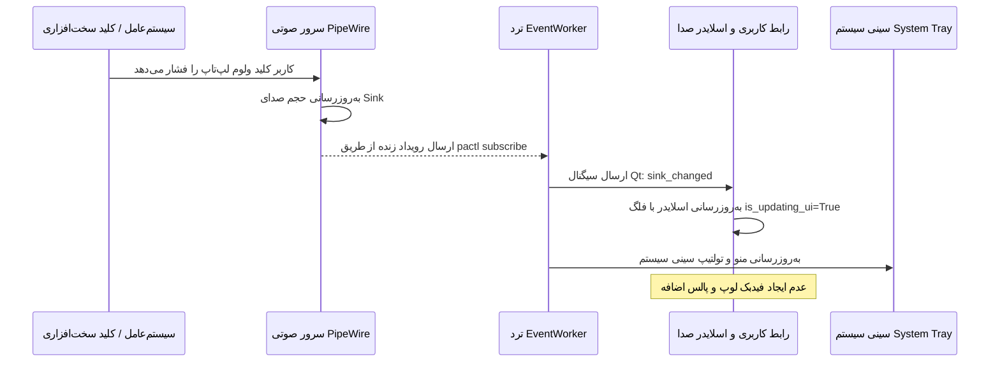

# مستندات معماری نرم‌افزار AM Audio Control
## تحلیل فنی و دیاگرام جریان داده‌ها و ارتباط با سیستم‌عامل

---

## ۱. ساختار لایه‌ای (Layered Architecture)

نرم‌افزار AM Audio Control بر اساس اصول مهندسی نرم‌افزار و معماری ماژولار چندلایه‌ای طراحی شده است:

```mermaid
graph TD
    UI[رابط کاربری PySide6 / Qt 6] --> Core[هسته منطق برنامه Core]
    UI --> Services[سرویس‌های پس‌زمینه Services]
    Services --> Core
    Core --> PipeWire[پایپ‌وایر PipeWire / PulseAudio]
    Core --> BlueZ[سرویس بلوتوث BlueZ D-Bus]
    Core --> XDG[فایل‌های استاندارد دیسک XDG]

    subgraph لایه واسط کاربر UI Layer
        UI_Dash[داشبورد DashboardPage]
        UI_Dev[دستگاه‌های صوتی DevicesPage]
        UI_BT[مدیریت بلوتوث BluetoothPage]
        UI_Set[تنظیمات SettingsPage]
        UI_Tray[سینی سیستم AppTrayIcon]
    end

    subgraph لایه هسته و منطق Core Layer
        AM[AudioManager]
        BM[BluetoothManager]
        PM[ProfileManager]
        CM[ConfigManager]
        SD[SystemDetector]
    end

    subgraph لایه سرویس‌ها و ورکرها Services Layer
        EW[EventWorker QThread - pactl subscribe]
        AS[AutostartService]
    end
```

---

## ۲. جریان رویدادها و همگام‌سازی زنده (Real-time Event Flow)

برای دستیابی به عملکرد آنی و جلوگیری از Polling مکرر، نرم‌افزار از سازوکار اشتراک رویدادهای PipeWire استفاده می‌کند:



---

## ۳. معماری ارتباط با بلوتوث و BlueZ

۱. **ارتباط مستقیم D-Bus:**
   نرم‌افزار از طریق گذرگاه سیستم (`SystemBus`) به آدرس سرویس `org.bluez` متصل می‌شود. با فراخوانی متد `GetManagedObjects` روی اینترفیس `org.freedesktop.DBus.ObjectManager`، تمامی آداپتورها و دستگاه‌های بلوتوث کشف می‌شوند.
۲. **درصد باتری واقعی:**
   تنها در صورتی که اینترفیس `org.bluez.Battery1` روی شیء دستگاه فعال باشد، مقدار خاصیت `Percentage` خوانده و به صورت واقعی به کاربر نمایش داده می‌شود.
۳. **سوئیچ هوشمند A2DP:**
   به محض شناسایی اتصال هدفون، هسته برنامه با فراخوانی `set_card_profile` پروفایل کارت را به `a2dp-sink` سوئیچ می‌کند تا بالاترین کیفیت صوتی برقرار شود.

---

## ۴. امنیت و پایداری فرآیندها

- **ممنوعیت `shell=True`:** تمامی دستورات سیستمی نظیر `pactl`, `wpctl` و `bluetoothctl` به صورت لیست آرگومان‌های مجزا بدون استفاده از مفسر شل اجرا می‌شوند تا از هرگونه خطر تزریق دستورات (Command Injection) ممانعت شود.
- **اعتبارسنجی ورودی‌ها:** پارامترهای حجم صدا بین ۰ تا ۱۰۰ مهار (Clamped) می‌شوند و آدرس‌های MAC با الگوی Regex استاندارد اعتبارسنجی می‌گردند.
- **جداسازی وظایف تردها:** عملیات شنود زنده در یک `QThread` مستقل انجام شده و هیچ‌گاه رابط گرافیکی دچار انجماد (GUI Freeze) نمی‌شود.
